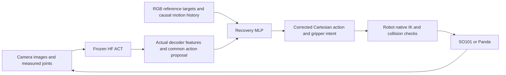

# Recovery MLP and DAgger experiments — 28–29 October 2026

The working fallback was an RGB geometric controller. The new recovery MLP is a
separate trainable model around the unchanged HF ACT. DAgger describes the
iterative corrective-label collection procedure, rather than the model which
executes an action. The geometric controller is the training expert and a
separate deployment baseline; learned-only evaluation never calls it for actions.



In training, an independent shadow environment is synchronized to the actual
learner state. Its RGB expert supplies a common Cartesian target label. A
declared probability chooses expert or learner execution; the next query sees
the resulting actual state. Aggregating these iterations supplies corrective
examples from learner-visited states. No teacher phase, simulator ball pose,
held flag or task success flag enters the MLP observation vector.

## Common interface

The output is `[TCP dx,dy,dz, world-frame rotation-vector dx,dy,dz, gripper open]`.
Translation and rotation are capped at 30 mm and 0.3 rad; gripper intent is 0–1.
Each robot executes this through native FK/IK and the supplied static collision
map. Panda retains the top-down grasp orientation used by its expert and existing
ACT adapter; this is a task orientation constraint, not general rotation transfer.

Three causal frames produce 99 observation values: measured TCP position,
rotation and velocity, measured jaw opening, RGB ball/bowl relative vectors,
visibility and ages, previous selected common action, embodiment ID, and time
since the selected jaw command changed. Frozen ACT provides its actual aligned
256-value decoder feature and common action proposal. The MLP has hidden widths
256 and 128 and seven action outputs. The no-ACT ablation masks both ACT inputs
and predicts directly from the same observable history.

Panda has more joints than common pose coordinates. A teacher which waits for its
original redundant joint branch can stall despite reaching the correct TCP.
Training expert convergence now follows measured TCP; native planning and hard
acceptance checks remain. Exact expert-action round trips through the common
interface completed 2/2 tasks on each arm before data collection.

The learned executor backtracks the magnitude of an infeasible predicted action,
without supplying a goal or changing its direction. Every candidate retains the
native workspace, pose, collision and sampled-path checks. A 3 mrad command margin
avoids driving arm joint stops. Tiny measured arm stop overshoot is handled only
as an IK seed; requested limits remain hard. Compliant jaw readback uses a bounded
solver seed while contacts are checked at the actual measured jaw pose.

## Initial-reference cohort

These models use cached initial RGB targets. They remain separate from tracked
references, because a learner can push the ball and invalidate the old goal.

| Collection | Expert action probability | Episodes per arm | Purpose |
| --- | ---: | ---: | --- |
| Iteration 0 | 1.0 | 12 train + 4 validation | Successful common-action teacher paths |
| Iteration 1 | 0.5 | 12 new train + 2 validation | Actual learner-visited corrective states |
| Iteration 2 | 0.25 | 8 new train + 2 validation | More learner execution and fewer expert interventions |

Iteration 0 completed 16/16 teacher tasks on each arm. Iteration 1 mixed
teacher/learner execution completed 8/14 SO101 and 7/14 Panda tasks, with one
retained SO101 abort. Iteration 2 completed 8/10 SO101 and 1/10 Panda mixed tasks.
Those collection outcomes are **not learned-only task success**.

The first paired 4,000-step heads fit held-out actions closely (ACT-head
translation MAE 0.634 mm; no-ACT 0.370 mm), yet both completed 0/2 development
tasks on each arm. A DAgger-trained ACT head subsequently completed one SO101
development task in 249 ticks without geometric teacher actions. Panda remained
unable to grasp in those tests. Executor fixes changed between some experiments;
the reports distinguish same-head execution retests from training comparisons.

The actual artifacts and detailed reasons are linked in:

- [Iteration 0 comparison](../results/v2/recovery_mlp_iteration0_comparison_20261028.json)
- [Iteration 1 comparison](../results/v2/recovery_mlp_iteration1_comparison_20261028.json)
- [Same-head executor retest](../results/v2/recovery_mlp_iteration1_executor_v2_retest_20261028.json)

## Tracked-reference cohort

`--reference-mode tracked` obtains fresh confident on-table RGB sphere detections
and refreshes observed bowl targets every five ticks. Occluded targets retain
their last measured reference with explicit visibility and age. The expert
replans after a displaced free ball is observed outside the observed bowl.
Both policy observations and expert labels use the same measured references.
The observation names use `fresh_rgb_`, so training rejects silent mixing with
the initial-reference cohort.

This responds to a measured failure: a learner pushes the ball, but a cached-goal
head and expert continue toward its original position. RGB tracking remains a
perception component at inference; the geometric planner remains training-only
for learned trials. No rendered depth or segmentation supplies object positions.

The first tracked collection completed 8/8 expert-controlled tasks per arm
(six training and two held-out episodes each). Its three fitted heads were then
evaluated without expert actions on development seeds 12000 and 12001:

| Tracked head | Best-checkpoint translation MAE | SO101 tasks | Panda tasks |
| --- | ---: | ---: | ---: |
| Frozen ACT + residual MLP | 0.915 mm | 0/2 | 0/2 |
| MLP without ACT inputs | 0.475 mm | 1/2 | 0/2 |
| Frozen ACT + phase-supervised MLP | 1.075 mm | 0/2 | 0/2 |

All twelve attempts completed without aborts or runtime source changes. These
small development trials are not a reliability estimate or reserved benchmark.
The [audited comparison](../results/v2/recovery_mlp_tracked0_comparison_20261029.json)
includes exact head/report/trace hashes, best-step validation metrics, rejection
reasons and video checks. The successful SO101 trial genuinely lifted and
released the ball into the bowl; it used no ACT calls or geometric actions.

The generic ACT head repeatedly proposes actions blocked by arm joint-stop
margins on SO101 and workspace limits on Panda. These checks remain enforced.
Feasible motion alone is insufficient: one phase-head Panda trial accepts all
750 IK requests yet never holds the ball, while predicting TRANSPORT for 229
ticks. Its 96.45% held-out phase accuracy describes expert intention, not grasp
verification. The teacher's post-step phase was also used for boundary labels
in these original packs; new collection labels follow the phase of the actual
issued command. Original packs and heads remain immutable.

Successful demonstrations cover only 0–3.36 seconds since the last selected jaw
switch. Failed generic-head rollouts reach 33 training standard deviations on
that input. New DAgger collection therefore targets actual prolonged failures,
rather than interpreting low held-out action error as complete-task success.

The RGB frontend estimates an **on-table** sphere reference. It retains the
last confident reference during lifting/occlusion; it does not track the carried
ball in 3D or verify a grasp. Visibility denotes detection at the latest refresh,
and age states time since the last successful measurement. Newly collected
expert plans compare against cumulative displacement from their planned ball
reference, so repeated small shifts cannot evade replanning. New evaluation
traces preserve visibility, ages and exact model inputs for diagnosis.

Tracked iteration 1 was collected with cumulative goal-drift detection, but its
carry-phase recovery still required the ball to move from that original goal.
An empty pickup can leave the ball unmoved on the table, so that rule missed
fresh RGB evidence that it was over 6 cm from the predicted carried position.
The corrected teacher checks that separation directly during CLOSE, LIFT,
TRANSPORT and LOWER; the 6 mm goal-drift threshold applies only before grasping.
It leaves ACQUIRE, terminal phases, RELEASE and RETREAT unchanged, without
starting new pickup attempts after completion or intentional release. Tracked
iteration 1 packs and heads trained from them retain the previous rule: this
code correction does not retroactively supply the missing corrective labels.

Tracked iteration 1 uses six new training episodes (15006–15011) and two new
validation episodes (16002–16003) per arm, with 50% expert action selection and
the previous tracked phase head executing the other selected actions. Its mixed
rollouts complete 4/8 SO101 and 2/8 Panda tasks, with 52 and 128 RGB replans
respectively; no attempts abort or change their source/lighting/checkpoint.
Aggregating tracked iterations 0 and 1 yields 6,126 training and 2,038 validation
rows. Initial-reference packs are excluded.

| Tracked iteration 1 head | Best-checkpoint translation MAE | SO101 tasks | Panda tasks |
| --- | ---: | ---: | ---: |
| Frozen ACT + residual MLP | 3.814 mm | 0/2 | 0/2, both aborted |
| MLP without ACT inputs | 2.689 mm | 0/2 | 0/2 |
| Frozen ACT + phase-supervised MLP | 4.089 mm | 1/2 | 1/2 |

These validation errors cover harder learner-visited states and cannot be
compared directly with iteration 0's easier validation set. The phase head
completes the SO101 and Panda tasks in 272 and 205 ticks, respectively, using
the actual frozen ACT decoder and no geometric actions. The two Panda residual
head aborts expose another boundary: Panda moves to a native-feasible pose which
cannot be represented by the virtual SO101 state within its declared 3 mm
mapping tolerance (residuals 14.603 and 7.636 mm). The exception is retained as a
failure rather than supplying a fictitious source state.

The [iteration 1 audit](../results/v2/recovery_mlp_tracked1_comparison_20261029.json)
verifies saved source snapshots, exact model inputs, reference ages and video
frames. Active ACT decoder features remain within 5.917 training standard
deviations in these tests; the largest observed extrapolations instead involve
reference ages and gripper-command time. One failed SO101 phase rollout predicts
LIFT for 434 ticks without ever holding the ball. Therefore neither phase
accuracy nor a feasible trajectory establishes a successful grasp. ACT
contribution is also not isolated by comparing a phase mixture against the
different generic no-ACT architecture.

The phase head was then frozen for eight additional fixed development seeds,
12002–12009, and completed **2/8 tasks on each arm**. Including the initial two
exploratory seeds gives **3/10 per arm**; the selected and additional splits
remain separate in the [20-trial audit](../results/v2/recovery_mlp_tracked1_phase_dev10_20261029.json).
No phase-head attempts abort. This does not meet 60% and the head remains
experimental; the geometric fallback stays the default.

Panda lifts in seven of the eight additional trials but fails transport in five.
Each of those five loses the ball during predicted LIFT while still commanding
nearly fully closed jaws, about 6.35–6.88 cm above the table and 31.3–33.5 cm
from the bowl. These are retention failures rather than intentional releases.
SO101's additional failures include three transport, two approach and one grasp
failure. Exact source/head hashes, full model-input traces and all 20 decoded
videos are recorded by the audit.

## Gate and phase pilots

The optional learned intervention gate is bound to exact ACT and recovery-head
hashes. All 4,978 training rows and 1,694 held-out rows in the first collection
required correction under the declared disagreement thresholds. Its conservative
artifact therefore keeps recovery on. It cannot demonstrate a useful off-switch
without genuine examples where ACT is sufficient.

The phase-supervised MLP predicts phase probabilities from the same observable
inputs and mixes per-phase action heads. Teacher phase is auxiliary supervision,
never an inference argument. Its first initial-reference pilot obtains 81.8%
held-out phase accuracy, but CLOSE recall is only 38.5% and LOWER recall 16.7%.
These labels describe intended expert motion, not verified physical grasping.
Action and phase validation scores are separate from closed-loop task success.

## Commands

```sh
# Initial teacher collection; use separate new seeds for each partition.
.venv/bin/python scripts/run_recovery_dagger.py collect --robot so101 \
  --out outputs/v2/recovery_teacher_NEW

# Train only the separately stored head, preserving the native HF checkpoint.
.venv/bin/python scripts/train_recovery_mlp.py \
  --data <completed-so101-pack> <completed-panda-pack> \
  --use-act --out outputs/v2/recovery_head_NEW

# Query the expert at actual learner-visited states for the next iteration.
.venv/bin/python scripts/run_recovery_dagger.py collect --robot so101 \
  --head <head-directory> --beta .5 --iteration 1 \
  --train-seeds 10012 10013 --val-seeds 11004 \
  --out outputs/v2/recovery_dagger_NEW

# Learned-only execution: RGB references + MLP + native IK, no geometric teacher.
.venv/bin/python scripts/run_recovery_dagger.py evaluate --robot panda \
  --head <head-directory> --seeds 12000 12001 --video \
  --out outputs/v2/recovery_eval_NEW
```

All experiment packs preserve frozen ACT hashes and unchanged lighting. Train,
validation, development and reserved evaluation seeds have separate roles. Model
selection never consumes reserved task outcomes. Failed and aborted trials remain
in task denominators; invalid/terminal expert labels are excluded explicitly from
new corrective packs. The earlier proven geometric pipeline remains the default
until a learned head establishes reliable complete-task performance.

New collection and evaluation directories preserve exact hashed text sources and
configuration copies in `executed_sources/`, with binary head/base weights
referenced by SHA256. Benchmark model options now hash the `head` directory and
all recovery dependencies, close model hooks after each trial, and support direct
and module factory invocation. Historical 600-trial benchmark reports retain the
exact executed benchmark source and remain unchanged.
