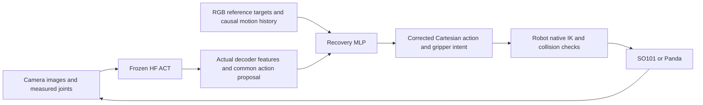

# Recovery MLP and DAgger experiments — 28 October 2026

The working fallback was an RGB geometric controller. The new recovery MLP is a
separate trainable model around the unchanged HF ACT. DAgger describes the
iterative corrective-label collection procedure, rather than the model which
executes an action. The geometric controller is the training expert and a
separate deployment baseline; learned-only evaluation never calls it for actions.



In training, an independent shadow environment is synchronized to the actual
learner state. Its RGB expert supplies a common Cartesian target label. A
declared probability chooses expert or learner execution; the next query sees
the resulting actual state. Aggregating these iterations supplies corrective
examples from learner-visited states. No teacher phase, simulator ball pose,
held flag or task success flag enters the MLP observation vector.

## Common interface

The output is `[TCP dx,dy,dz, world-frame rotation-vector dx,dy,dz, gripper open]`.
Translation and rotation are capped at 30 mm and 0.3 rad; gripper intent is 0–1.
Each robot executes this through native FK/IK and the supplied static collision
map. Panda retains the top-down grasp orientation used by its expert and existing
ACT adapter; this is a task orientation constraint, not general rotation transfer.

Three causal frames produce 99 observation values: measured TCP position,
rotation and velocity, measured jaw opening, RGB ball/bowl relative vectors,
visibility and ages, previous selected common action, embodiment ID, and time
since the selected jaw command changed. Frozen ACT provides its actual aligned
256-value decoder feature and common action proposal. The MLP has hidden widths
256 and 128 and seven action outputs. The no-ACT ablation masks both ACT inputs
and predicts directly from the same observable history.

Panda has more joints than common pose coordinates. A teacher which waits for its
original redundant joint branch can stall despite reaching the correct TCP.
Training expert convergence now follows measured TCP; native planning and hard
acceptance checks remain. Exact expert-action round trips through the common
interface completed 2/2 tasks on each arm before data collection.

The learned executor backtracks the magnitude of an infeasible predicted action,
without supplying a goal or changing its direction. Every candidate retains the
native workspace, pose, collision and sampled-path checks. A 3 mrad command margin
avoids driving arm joint stops. Tiny measured arm stop overshoot is handled only
as an IK seed; requested limits remain hard. Compliant jaw readback uses a bounded
solver seed while contacts are checked at the actual measured jaw pose.

## Initial-reference cohort

These models use cached initial RGB targets. They remain separate from tracked
references, because a learner can push the ball and invalidate the old goal.

| Collection | Expert action probability | Episodes per arm | Purpose |
| --- | ---: | ---: | --- |
| Iteration 0 | 1.0 | 12 train + 4 validation | Successful common-action teacher paths |
| Iteration 1 | 0.5 | 12 new train + 2 validation | Actual learner-visited corrective states |
| Iteration 2 | 0.25 | 8 new train + 2 validation | More learner execution and fewer expert interventions |

Iteration 0 completed 16/16 teacher tasks on each arm. Iteration 1 mixed
teacher/learner execution completed 8/14 SO101 and 7/14 Panda tasks, with one
retained SO101 abort. Iteration 2 completed 8/10 SO101 and 1/10 Panda mixed tasks.
Those collection outcomes are **not learned-only task success**.

The first paired 4,000-step heads fit held-out actions closely (ACT-head
translation MAE 0.634 mm; no-ACT 0.370 mm), yet both completed 0/2 development
tasks on each arm. A DAgger-trained ACT head subsequently completed one SO101
development task in 249 ticks without geometric teacher actions. Panda remained
unable to grasp in those tests. Executor fixes changed between some experiments;
the reports distinguish same-head execution retests from training comparisons.

The actual artifacts and detailed reasons are linked in:

- [Iteration 0 comparison](../results/v2/recovery_mlp_iteration0_comparison_20261028.json)
- [Iteration 1 comparison](../results/v2/recovery_mlp_iteration1_comparison_20261028.json)
- [Same-head executor retest](../results/v2/recovery_mlp_iteration1_executor_v2_retest_20261028.json)

## Tracked-reference cohort

`--reference-mode tracked` obtains fresh confident on-table RGB sphere detections
and refreshes observed bowl targets every five ticks. Occluded targets retain
their last measured reference with explicit visibility and age. The expert
replans after a displaced free ball is observed outside the observed bowl.
Both policy observations and expert labels use the same measured references.
The observation names use `fresh_rgb_`, so training rejects silent mixing with
the initial-reference cohort.

This responds to a measured failure: a learner pushes the ball, but a cached-goal
head and expert continue toward its original position. RGB tracking remains a
perception component at inference; the geometric planner remains training-only
for learned trials. No rendered depth or segmentation supplies object positions.

## Gate and phase pilots

The optional learned intervention gate is bound to exact ACT and recovery-head
hashes. All 4,978 training rows and 1,694 held-out rows in the first collection
required correction under the declared disagreement thresholds. Its conservative
artifact therefore keeps recovery on. It cannot demonstrate a useful off-switch
without genuine examples where ACT is sufficient.

The phase-supervised MLP predicts phase probabilities from the same observable
inputs and mixes per-phase action heads. Teacher phase is auxiliary supervision,
never an inference argument. Its first initial-reference pilot obtains 81.8%
held-out phase accuracy, but CLOSE recall is only 38.5% and LOWER recall 16.7%.
These labels describe intended expert motion, not verified physical grasping.
Action and phase validation scores are separate from closed-loop task success.

## Commands

```sh
# Initial teacher collection; use separate new seeds for each partition.
.venv/bin/python scripts/run_recovery_dagger.py collect --robot so101 \
  --out outputs/v2/recovery_teacher_NEW

# Train only the separately stored head, preserving the native HF checkpoint.
.venv/bin/python scripts/train_recovery_mlp.py \
  --data <completed-so101-pack> <completed-panda-pack> \
  --use-act --out outputs/v2/recovery_head_NEW

# Query the expert at actual learner-visited states for the next iteration.
.venv/bin/python scripts/run_recovery_dagger.py collect --robot so101 \
  --head <head-directory> --beta .5 --iteration 1 \
  --train-seeds 10012 10013 --val-seeds 11004 \
  --out outputs/v2/recovery_dagger_NEW

# Learned-only execution: RGB references + MLP + native IK, no geometric teacher.
.venv/bin/python scripts/run_recovery_dagger.py evaluate --robot panda \
  --head <head-directory> --seeds 12000 12001 --video \
  --out outputs/v2/recovery_eval_NEW
```

All experiment packs preserve frozen ACT hashes and unchanged lighting. Train,
validation, development and reserved evaluation seeds have separate roles. Model
selection never consumes reserved task outcomes. Failed and aborted trials remain
in task denominators; invalid/terminal expert labels are excluded explicitly from
new corrective packs. The earlier proven geometric pipeline remains the default
until a learned head establishes reliable complete-task performance.
